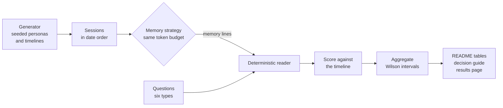

# recallbench

[](https://github.com/shreyas-tech7/recallbench/actions/workflows/ci.yml)

**Status:** v0.1.0-rc1. The offline benchmark works end to end. Dense embeddings and the LLM record mode could not run on the build machine. Everything below says which numbers exist and which do not.

recallbench tests how agent memory strategies keep, update and forget facts across many chat sessions. It scores recall, stale facts and whether deleted facts stay gone. It also counts the tokens each strategy hands to the reader, so cost sits next to accuracy.

## The problem

An assistant with memory has three jobs. It must recall a fact from weeks ago. It must give the latest value after the fact changes ("we moved to Denver"). And when a user says "forget my address", the address must never come back.

Most memory benchmarks test the first job well. LongMemEval tests five abilities: information extraction, multi-session reasoning, temporal reasoning, knowledge updates and abstention. Few report what happens to a deleted fact. That gap matters for any team that adds memory to a product, because a user who asked you to forget something will notice when you don't.

recallbench gives a team that must pick a memory strategy three numbers per strategy: accuracy by question type, the rate of stale or deleted facts it returns, and its tokens per answer.

## How it works



1. **Generate.** A seeded generator invents 20 personas with 10 to 30 sessions each. Facts arrive (job, city, pet, favorite food, hobby, trip, address, car), change and get deleted. They also come up in passing inside small talk. Near-miss lines about other people ("My sister lives in Austin") sit in the mix. Every fact has a ground truth timeline.
2. **Ingest.** Each strategy reads the sessions in order. It never sees a question during ingestion. A test checks that.
3. **Ask.** Every question is asked the day after the last session. The six types are single fact, updated fact, multi-session, temporal, abstention and forgotten. A temporal question names the fact, never its value ("On what date did I first mention my current city?"), so it gives retrieval no word to match on.
4. **Read.** The strategy returns dated memory lines within the token budget. The deterministic reader answers from those lines only.
5. **Score.** The answer is compared to the timeline. The stale-fact rate and forget violations come from the same rows.
6. **Report.** A script writes every number on this page from the results files.

The five strategies:

| Strategy | What it keeps | What it returns |
| --- | --- | --- |
| `full_context` | every user turn | the newest user turns that fit the budget, with no gaps |
| `rolling_summary` | user lines with a fact word, scripted summarizer | the summary, oldest lines dropped when over budget |
| `vector_recall` | one chunk per user turn, hash embedder | chunks in order of cosine similarity until the budget is full |
| `profile_store` | key and value facts in SQLite, a new value supersedes, a forget request deletes the slot and its history | every current fact as one canonical line |
| `hybrid` | the profile store plus vector recall, a forget request also drops matching chunks | profile lines first, then chunks in the budget that is left |

### How the reader finds an answer

The reader sorts the returned lines by date. It runs hand-written patterns over each line. A pattern matches a first-person statement about one slot ("I live in Denver", "We moved to Boise") or a forget request ("Please forget where I live"). Lines about other people match nothing. It replays the matches in date order: a statement sets the value, a later one replaces it, and a forget request clears it. Then it parses the question text and reads the answer off that state. No value means `unknown`. The code and its docstring are in [src/recallbench/reader.py](src/recallbench/reader.py).

The reader is exact on any line it gets, because its patterns were written against the generator's phrasing. So a wrong answer means the strategy returned the wrong lines. That isolates the memory strategy, which is the thing under test.

## Results

<!-- gen:results -->
Run of 2026-11-21, model: none (deterministic reader, scripted summarizer, hash-512 embedder), seed 4049 (never used while building, tuning used seed 1), budget 512 tokens per answer, 20 personas, 427 sessions, 265 questions. File `results/final-seed4049.json`.

Accuracy by question type, with 95% Wilson intervals:

| Strategy | Single fact | Updated fact | Multi-session | Temporal | Abstention | Forgotten | All |
| --- | --- | --- | --- | --- | --- | --- | --- |
| `full_context` | 45% (26 to 66) | 81% (68 to 89) | 46% (33 to 59) | 69% (56 to 79) | 100% (91 to 100) | 100% (92 to 100) | 75% (69 to 80) |
| `rolling_summary` | 100% (84 to 100) | 100% (93 to 100) | 100% (93 to 100) | 100% (94 to 100) | 100% (91 to 100) | 100% (92 to 100) | 100% (99 to 100) |
| `vector_recall` | 95% (76 to 99) | 88% (77 to 95) | 83% (70 to 91) | 72% (60 to 82) | 100% (91 to 100) | 93% (81 to 98) | 87% (82 to 90) |
| `profile_store` | 100% (84 to 100) | 100% (93 to 100) | 100% (93 to 100) | 100% (94 to 100) | 100% (91 to 100) | 100% (92 to 100) | 100% (99 to 100) |
| `hybrid` | 100% (84 to 100) | 100% (93 to 100) | 100% (93 to 100) | 100% (94 to 100) | 100% (91 to 100) | 100% (92 to 100) | 100% (99 to 100) |
<!-- /gen:results -->

Stale facts, forgetting and cost, from the same run:

<!-- gen:risks -->
| Strategy | Stale-fact rate | Forget violations, forgotten questions | Forget violations, any question | Deleted value given as answer | Tokens per answer (mean) |
| --- | --- | --- | --- | --- | --- |
| `full_context` | 0/52 = 0.0% (0.0 to 6.9) | 14/42 = 33.3% (21.0 to 48.4) | 61/265 = 23.0% (18.4 to 28.5) | 0/42 = 0.0% (0.0 to 8.4) | 514 |
| `rolling_summary` | 0/52 = 0.0% (0.0 to 6.9) | 42/42 = 100.0% (91.6 to 100.0) | 265/265 = 100.0% (98.6 to 100.0) | 0/42 = 0.0% (0.0 to 8.4) | 437 |
| `vector_recall` | 6/52 = 11.5% (5.4 to 23.0) | 41/42 = 97.6% (87.7 to 99.6) | 202/265 = 76.2% (70.7 to 81.0) | 3/42 = 7.1% (2.5 to 19.0) | 516 |
| `profile_store` | 0/52 = 0.0% (0.0 to 6.9) | 0/42 = 0.0% (0.0 to 8.4) | 0/265 = 0.0% (0.0 to 1.4) | 0/42 = 0.0% (0.0 to 8.4) | 61 |
| `hybrid` | 0/52 = 0.0% (0.0 to 6.9) | 0/42 = 0.0% (0.0 to 8.4) | 0/265 = 0.0% (0.0 to 1.4) | 0/42 = 0.0% (0.0 to 8.4) | 516 |
<!-- /gen:risks -->

A forget violation counts a question where any returned line names any value the persona asked to forget, whatever the question asks about. The first column counts this on forgotten-fact questions only, and the second on every question. The next column counts the cases where the reader also gave that value as the answer. The deterministic reader usually skips a deleted value because it also sees the forget request. An LLM reader may not, and the text has left the store either way.

<!-- gen:second -->
Some rows reach 100%, which looks too good. So the same run went again on seed 90210 (file `results/second-seed90210.json`). A second seed rules out a lucky draw. It does not remove the design reason: the profile store and the scripted summarizer share the generator's phrasing (see Limits).

| Strategy | All, seed 4049 | All, seed 90210 | Forget violations, seed 4049 | Forget violations, seed 90210 |
| --- | --- | --- | --- | --- |
| `full_context` | 75% (69 to 80) | 66% (60 to 71) | 33% (21 to 48) | 46% (31 to 62) |
| `rolling_summary` | 100% (99 to 100) | 100% (99 to 100) | 100% (92 to 100) | 100% (91 to 100) |
| `vector_recall` | 87% (82 to 90) | 89% (85 to 92) | 98% (88 to 100) | 100% (91 to 100) |
| `profile_store` | 100% (99 to 100) | 100% (99 to 100) | 0% (0 to 8) | 0% (0 to 9) |
| `hybrid` | 100% (99 to 100) | 100% (99 to 100) | 0% (0 to 8) | 0% (0 to 9) |
<!-- /gen:second -->

Accuracy and forget violations by token budget:

<!-- gen:sweep -->
Same seed 4049, budgets from 128 to 1024 tokens:

| Strategy | All, budget 128 | All, budget 256 | All, budget 512 | All, budget 1024 | Forget violations, budget 128 | Forget violations, budget 256 | Forget violations, budget 512 | Forget violations, budget 1024 |
| --- | --- | --- | --- | --- | --- | --- | --- | --- |
| `full_context` | 43% (37 to 49) | 55% (49 to 61) | 75% (69 to 80) | 87% (83 to 91) | 0% (0 to 8) | 29% (17 to 44) | 33% (21 to 48) | 95% (84 to 99) |
| `rolling_summary` | 57% (51 to 62) | 79% (74 to 83) | 100% (99 to 100) | 100% (99 to 100) | 12% (5 to 25) | 86% (72 to 93) | 100% (92 to 100) | 100% (92 to 100) |
| `vector_recall` | 74% (68 to 79) | 82% (76 to 86) | 87% (82 to 90) | 94% (90 to 96) | 90% (78 to 96) | 93% (81 to 98) | 98% (88 to 100) | 100% (92 to 100) |
| `profile_store` | 100% (99 to 100) | 100% (99 to 100) | 100% (99 to 100) | 100% (99 to 100) | 0% (0 to 8) | 0% (0 to 8) | 0% (0 to 8) | 0% (0 to 8) |
| `hybrid` | 100% (99 to 100) | 100% (99 to 100) | 100% (99 to 100) | 100% (99 to 100) | 0% (0 to 8) | 0% (0 to 8) | 0% (0 to 8) | 0% (0 to 8) |
<!-- /gen:sweep -->

### Record mode (LLM summarizer and reader)

<!-- gen:record -->
Record mode did not run. Checked on 2026-11-21: no GROQ_API_KEY in the environment, so no request was sent. On the build machine the free provider hosts also refused the connection (see `docs/ENVIRONMENT.md`). So every number on this page comes from the deterministic reader and the scripted summarizer. The LLM summarizer and the LLM reader exist in `src/recallbench/llm.py` and pass their tests against a fake local server.
<!-- /gen:record -->

### Dense recall

The FastEmbed model `BAAI/bge-small-en-v1.5` could not download on the build machine (Hugging Face blocked, the Google Storage copy denied). Every `vector_recall` and `hybrid` number above uses the offline hash embedder. Dense recall is blocked and untested. Run it with `recallbench run --embedder fastembed` on a machine that can reach Hugging Face.

For a short guide to picking a strategy from these numbers, read [docs/DECISION_GUIDE.md](docs/DECISION_GUIDE.md). The same tables as a page that opens from disk: [docs/index.html](docs/index.html).

## Cost per task

<!-- gen:cost -->
Tokens per answer counts the memory lines a strategy returns plus the question (seed 4049, budget 512).
The cheapest strategy is `profile_store` at 61 tokens. The most expensive is `hybrid` at 516 tokens.
For 1,000 answers that is 61k against 516k input tokens for an LLM reader.
The deterministic reader costs no tokens. The main run plus the budget sweep (5 strategies at 4 budgets, the 512-token row reused from the main run) took 3.0 seconds on one core of `Intel(R) Xeon(R) Processor @ 2.30GHz` on 2026-11-21.
<!-- /gen:cost -->

## Run it in 10 minutes

You need Python 3.11 or newer and git. No key, no sign-in and no network after the install.

```bash
git clone https://github.com/shreyas-tech7/recallbench.git
cd recallbench
./init.sh                                  # venv, install, lint, link check, all tests offline
.venv/bin/recallbench truth --seed 1       # replay every transcript, check every answer
.venv/bin/recallbench demo                 # 3 personas, the table, and what each strategy returns for a deleted fact
.venv/bin/recallbench run --seed 5 --out results/mine.json
.venv/bin/recallbench generate --seed 5 --out data   # the personas and questions as JSONL
```

Open `docs/index.html` in a browser for the results page. [docs/DEMO.md](docs/DEMO.md) holds a real terminal transcript.

Exit codes:

| Code | Meaning |
| --- | --- |
| 0 | success |
| 1 | a check failed (`truth` found a wrong answer, `readme --check` found stale blocks) |
| 2 | refused: final numbers from the tuning seed, or bad arguments |
| 3 | record mode blocked: no provider key |

To add a strategy, subclass `Strategy` in [src/recallbench/strategies.py](src/recallbench/strategies.py), give it `ingest`, `retrieve` and `dump`, and add it to `NAMES` and `make`. The budget, leak and forget tests then run on it.

## Limits

- All data is synthetic. Real users phrase facts in endless ways. The generator uses a few templates per fact, so the profile store extractor and the reader both know the phrasing. Treat the `profile_store` and `hybrid` rows as an upper bound for a store whose extractor never misses.
- The deterministic reader never guesses. So abstention is easy for it, and the abstention column mostly tests whether a strategy returns a near-miss line. An LLM reader can hallucinate, and only record mode would show that.
- The vector numbers use a hash embedder, not a trained model. Dense recall may rank better or worse.
- Record mode did not run, so no number here comes from an LLM.
- Every question is asked after the last session. Questions in the middle of a timeline are not covered.
- The token count is a regex count of words and punctuation. It tracks a real tokenizer closely on plain English but is not exact.
- Questions per type and per seed are in the tens, so the intervals are wide. Read the interval, not the point.
- The Wilson intervals treat every question as independent. Questions from one persona share one memory, about 13 per persona, so the true intervals are somewhat wider.
- The scripted summarizer keeps user lines that hold a fact word, and those words come from the generator's templates. So its accuracy at a large budget is also an upper bound. Its forget violations are real: it never acts on a forget request.
- The extractor and the reader match the generator's exact phrasing. "Delete my address" with a capital D, or a fact set again after a forget, is not tested.

## Glossary

- **Budget:** the most tokens a strategy may return for one question. The same for every strategy.
- **Forget violation:** a returned line names a value that the user asked to forget, on any question.
- **Stale fact:** the answer is an old value after the user gave a new one.
- **Abstention:** the right answer is `unknown` because the user never said it.
- **Deterministic reader:** fixed rules that turn memory lines into an answer. No model.
- **Hash embedder:** turns text into a vector by hashing its words and letter groups. No download.
- **Wilson interval:** a 95% confidence interval for a rate that behaves well near 0 and 1.
- **Tuning seed:** the one seed used while building. The final numbers use a seed never used before.

## Related work

- [LongMemEval](https://arxiv.org/abs/2410.10813) tests five long-term memory abilities with 500 questions and reports a large accuracy drop for chat assistants across sustained interactions.
- [LoCoMo](https://arxiv.org/abs/2402.17753) tests very long conversations with question answering and summarization.
- [Mem0](https://github.com/mem0ai/mem0), [Letta](https://github.com/letta-ai/letta) (formerly MemGPT) and [Zep](https://github.com/getzep/zep) are memory systems.

What recallbench adds: a forgetting metric, a stale-fact rate, tokens per answer next to accuracy, and a run that needs no network or model.

## How this was built

AI agents wrote most of the code under Shreyas's direction. The full build brief is in [docs/build/BUILD_PROMPT.md](docs/build/BUILD_PROMPT.md). Choices and their reasons are in [DECISIONS.md](DECISIONS.md). What failed is in [BLOCKERS.md](BLOCKERS.md).

Human checks, not done yet:

- Shreyas reads the generator and confirms the timelines look like real chat facts.
- Shreyas reruns `./init.sh` and the final seed on his own machine.
- Shreyas runs record mode with a free provider key.

MIT licensed. See [LICENSE](LICENSE).
